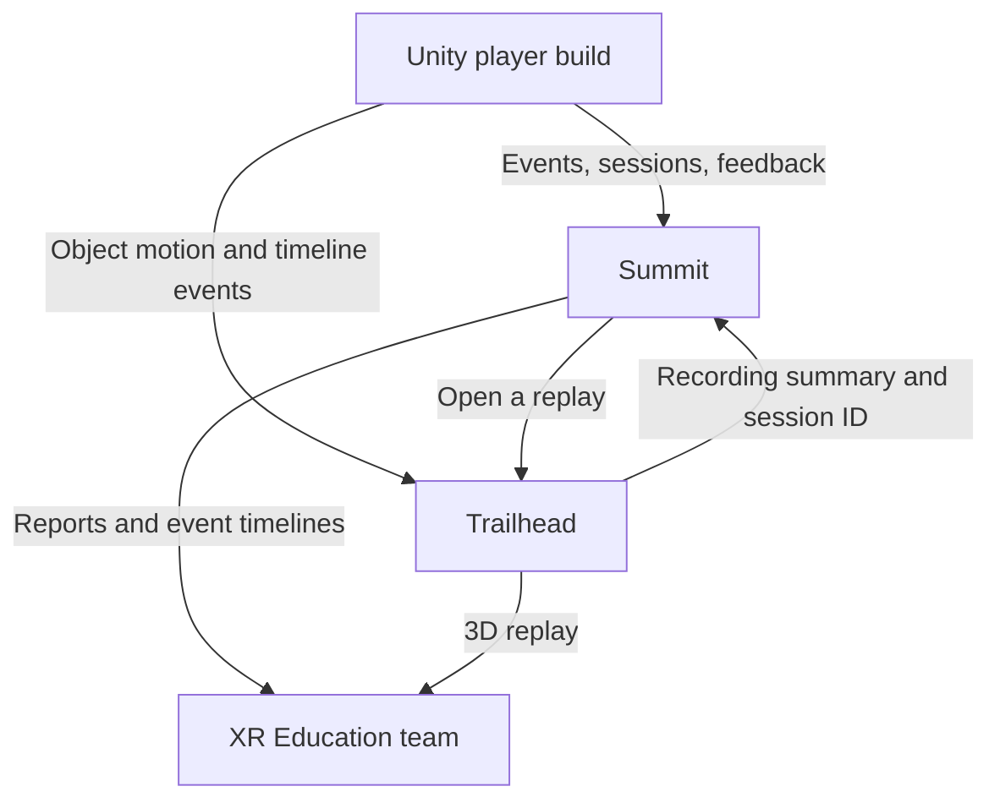
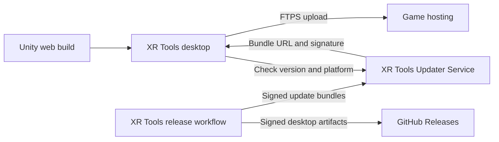

# XR Education tools

A player places a defense in SludgeTower. Summit can count that placement
across sessions. Trailhead can show where it happened on the board and which
objects moved around it. The two views use the same Summit session ID to
take you from an analytics question to a moment you can replay.

## Find the right guide

| I want to | Open |
| --- | --- |
| Send analytics or see what players do across sessions | [Summit](summit/index.md) |
| Record tracked objects or inspect a specific play session | [Trailhead](trailhead/index.md) |
| Trace the board and waypoint paths in a working Unity example | [Waste Management](waste-management/index.md) |
| Upload a web build or work on the desktop utilities | [XR Tools](xr-tools/index.md) |
| Check a signed desktop update for a platform | [XR Tools Updater Service](xr-tools-updater-service/index.md) |
| Understand the ScrutinyXR authoring tool, its backend and the Unity 6 upgrade | [ScrutinyXR](scrutinyxr/index.md) |

## Trace a game session

1. Give both Unity clients the same pseudonymous player ID.
2. When Summit returns a session UUID, attach it to the Trailhead recording.
3. Send analytics to Summit and replay data to Trailhead during or after play,
   according to the recording client in the game.
4. Open the session in Summit and follow the Trailhead link after the summary
   sync. The replay's recording ID is separate from the Summit session UUID.

[Connect Summit and Trailhead in Unity](summit/unity.md) or try the
[SludgeTower verification walkthrough](waste-management/verify.md). For
experience-specific material, see the existing
[Unity XR user documentation](https://github.com/Unity-Environmental-University/XR-User-Documentation)
and the [Horticulture developer docs](https://github.com/Unity-Environmental-University/Horticulture-Scripts/tree/main/docs).

## Ship the build and update the desktop app

XR Tools uploads web builds. Its updater service distributes new versions of
the XR Tools desktop app. Use the [test deployment guide](xr-tools/deploy.md)
for a web build and the [updater checks](xr-tools-updater-service/verify.md) for
a desktop release.
