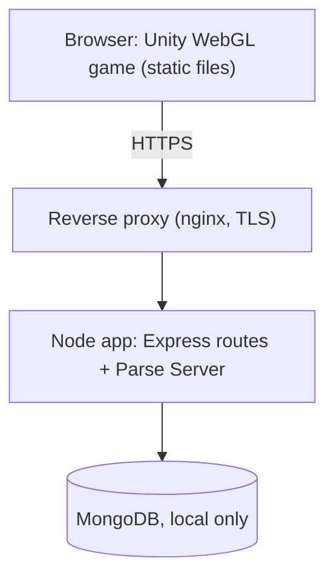

# ScrutinyXR 3D Authoring Tool

ScrutinyXR is a Unity WebGL game where users walk through 3D rooms, place and annotate models in Author mode, and save scenes to a web backend. A saved scene can be shared with a link such as `https://scrutinyxr.com/?scene=<id>`. This guide records how the system works and what we learned when the backend and the Unity project were modernized in October 2026.

Operational details (hosts, credentials, access and open hardening work) are kept in the project's private repository and are not part of this portal.

## How the pieces fit



- One small server runs the proxy, the Node app and MongoDB.
- The Node app serves the game as static files and also exposes the game's custom API and Parse Server.
- The app calls its own public URL for Parse, so Parse's default master-key IP allow-list (localhost) works because those calls return through the proxy on the same host.
- MongoDB listens on loopback only and must never be exposed.
- A `dev` router and database exist (`DEV_SERVER=true`), but nothing serves them in production.

### Backend stack

| Component | Version after the upgrade |
| --- | --- |
| Node | 22 LTS (manual install, so patching is manual) |
| Parse Server | 9.x |
| Parse Dashboard | 9.x |
| MongoDB | 7.0 |
| Process manager | systemd, non-root service user |

## API routes

The game does not use Parse's REST API or session tokens. It calls these custom routes and passes user ids, which is why upgrading Parse did not sign anyone out.

| Route | Method | Behavior |
| --- | --- | --- |
| `/bonjour` | GET | Health text |
| `/createUser` | POST | `{Username, Email, Password}` returns `{Id, Username, Email}`; HTTP 400 with error JSON on failure |
| `/login` | POST | `{user, pwd}` returns `userId\|email`, or `invalid` |
| `/savescene` | POST | Saves scene JSON. An unknown scene id creates a new scene |
| `/loadscene` | POST | `{id}` returns the scene JSON. An unknown id never responds |
| `/loadscenes` | POST | `{id: userId}` returns that user's scenes |
| `/deletescene` | POST | Deletes by id |
| `/feedback`, `/modelrequest` | POST | Email routes, being replaced by a feedback-form webhook |

Cloud code (`cloud/main.js`) defines `getSceneFromId`, `getScenesOfUser`, `saveScene` and `deleteSceneFromId`.

## The Unity project

- Source control is Unity Version Control (Plastic SCM), not git. The upgrade lives on the branch `feat-unity-6-upgrade`.
- The project mounts a second repository, `UC_UnitySubsystem`, at `Assets/_UC_UnitySubsystem`. A complete change needs a branch in both repositories.
- Editor: Unity 6000.6 (URP 17.6, Input System 1.20). The original was 2021.1.
- `Manager.cs` selects the server and holds the `UseDevServer`, `Local` and `Online` flags. `ParseClient.cs` holds the routes. The scene `ScrutinyUIRevamp.unity` serializes `UseDevServer=1`, so **a source build targets `/dev`. Set it to 0 before any release.**
- Seven plugins that do not compile on Unity 6 were removed from the branch (they remain in `/main`).

### Headless WebGL build

```bash
CI_BUILD_OUT=/path/to/output \
"/Applications/Unity/Hub/Editor/6000.6.0f1/Unity.app/Contents/MacOS/Unity" \
  -batchmode -nographics -projectPath "/path/to/project" \
  -buildTarget WebGL -executeMethod CiBuild.BuildWebGL -logFile build.log
```

- `CiBuild` forces compression off, because the static file server does not send `Content-Encoding` for `.br` or `.gz`. If you change that, change the server too.
- Read the `unity exit code:` line in the log; the wrapper's exit status can hide it. A build takes 10 to 15 minutes.

### The WebGL out-of-memory fix

A Unity 6 WebGL build aborted at startup with `abort("OOM")`. URP 17.6 only filters the three `META_QUEST_*` shader keywords on Meta Quest builds. On WebGL they multiplied every Lit ForwardLit variant by 8, giving 56,448 variants and a 1.8 GB uncompressed shader blob.

`Assets/Editor/WebGLShaderVariantStripper.cs` strips unused variants for WebGL only, leaving 4,032 (Lit 88 MB). Keep it when changing URP or shader settings. Raising the memory cap or switching input handlers did not help.

Possible small visual losses: no LOD cross-fade dither, no reflection-probe blending, no light cookies or layers, and Low/High soft shadows fall back to Medium.

### Other Unity 6 changes worth knowing

- API renames: `PhysicMaterial` to `PhysicsMaterial`, `GetInstanceID()` to `GetEntityId()`.
- `UI_Desktop.prefab` children were reordered. Without that the screen is plain blue after sign-in, because 2021-era `m_RootOrder` overrides are ignored by newer editors.
- `UCS_ScenePersistent.Awake` now checks `lazyInstance.IsValueCreated` first, fixing an `InvalidOperationException` that also occurs in the 2021 build.

## Shipping a new client build

This procedure is derived from how the current build is served and has not been run in production.

1. Set `UseDevServer` to 0, rebuild, and test against a local replica of the backend.
2. Back up the server's `public/` folder.
3. Upload the new `index.html`, `Build/` and `TemplateData/`. No app restart is needed.
4. Test sign-up, login, save, reload, a `?scene=` share link and an existing account.
5. To roll back, restore the backed-up `public/` folder.

## Lessons from the upgrade

- **Test on a replica first.** A Docker replica built from a production backup caught four real problems before cutover.
- **Parse 5+ gives new users a private ACL.** Cloud code must use `{ useMasterKey: true }` for user lookups and `Parse.User` rather than the string `'User'`. Omitting it makes saves fail silently for new users.
- **Never pass `masterKeyIps: undefined` to Parse.** It crashes at startup.
- **Return a 4xx for failed sign-ups.** The Unity client treats a 200 with an error body as a signed-in blank user.
- **Compare restores against the dump files.** The old Mongo 3.6 shell's `count()` can be stale; use `countDocuments()` or count documents in the `.bson` files.
- **Escape `$` as `$$` in Compose env files** that contain bcrypt hashes, or they are truncated.
- **Do not copy `node_modules` between architectures.** Run `npm ci` on the server.
- **Mind the PATH.** `/usr/local/bin` precedes `/usr/bin`, so a manually installed Node shadows the system Node. Link a new Node only after the old process is stopped.
- **Keep `DATABASE_URI` explicit** as `mongodb://127.0.0.1:27017/live`.
- **Plastic quirks.** A `/` in a branch name means a child branch. `cm diff` can open a GUI and hang; use `cm cat "path#cs:N" --file=out` and `diff`. Exclusive checkouts can block check-in and should only be unlocked with the lock owner's approval.

## Known gaps

- A Unity 6 client built from the branch has been tested only against the replica, not the live server.
- The email routes have not worked in production and are due to be replaced.
- The backend source is not yet under version control.
- The OS is out of standard support and needs an extended-support plan or a release upgrade.
