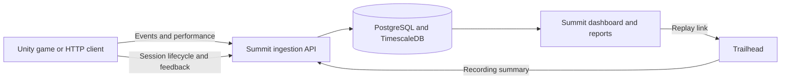

# Summit

Summit collects game analytics. Use it to find which levels players finish,
which steps they repeat, and whether frame rate changes after a release. It can
also link a session to its 3D replay in Trailhead.

Start with [one synthetic event](first-event.md) if you are setting up the
service. If you are working on a Unity build, see
[Connect a Unity game](unity.md). For dashboard tasks and API entry points,
see the [data and reporting reference](data.md).

## How an event reaches a report

The API validates game data before writing it to PostgreSQL. TimescaleDB
organizes time-series events and performance samples. Dashboard queries use
that data for individual sessions and aggregate views.

A player can have multiple sessions. A session can have multiple Trailhead
recordings. Summit stores a summary and replay link for each synced recording.
Trailhead keeps the frames and events that make up the replay.

## Source map

| Area | Location |
| --- | --- |
| Game instrumentation | [Unity client and API examples](https://github.com/Unity-Environmental-University/Summit/tree/main/clients/unity) |
| Next.js dashboard and API | [Dashboard source](https://github.com/Unity-Environmental-University/Summit/tree/main/dashboard) |
| PostgreSQL schema | [SQL migrations](https://github.com/Unity-Environmental-University/Summit/tree/main/backend/migrations) |
| Local setup and branch promotion | [Project README](https://github.com/Unity-Environmental-University/Summit#readme) |
