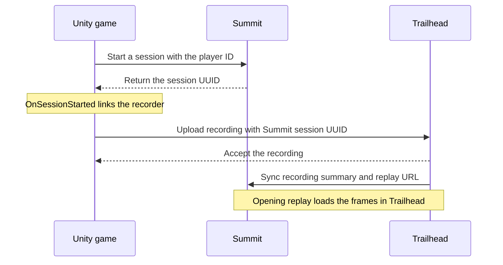

# Connect a Unity game to Summit

Install [`SummitAnalytics.cs`](https://github.com/Unity-Environmental-University/Summit/blob/main/clients/unity/SummitAnalytics.cs)
on a persistent GameObject. Set `apiUrl` to the Summit origin and `apiKey` to the
game's app key. `SummitAnalytics` supplies the `/summit` path itself. Test
the network flow in a player build because analytics uploads are disabled in
the Unity Editor.

## Instrument a session

Use a stable pseudonymous player ID. Call `Identify` before you start a session
or queue that player's first event.

```csharp
analytics.Identify(playerId);
analytics.StartSession(appVersion: Application.version);
analytics.Track("checkpoint_reached", numericValue: 1f);
```

Use the same event name for every occurrence of the same action. Put the level,
checkpoint, or other changing context in `properties`. Put named numeric values,
such as elapsed seconds, in `properties.measurements`. Send durable device
details with `SendHardwareProfile()`. Call `EndSession()` where your game marks
the end of the play session.

## Link a Trailhead replay

Subscribe to `OnSessionStarted` before you call `StartSession`. Pass the
received ID and the same player ID to Trailhead's `LinkSummitSession`.



The recorder can start while Summit is still opening the session.
`OnSessionStarted` runs when Summit issues an ID, including after a successful
retry. Check for `summit_session_id` on the saved recording if it appears in
Trailhead but is missing from the Summit session.

For the full SDK, including the Virtual Forest handshake and player feedback
components, use the [Unity client guide](https://github.com/Unity-Environmental-University/Summit/tree/main/clients/unity#readme).
