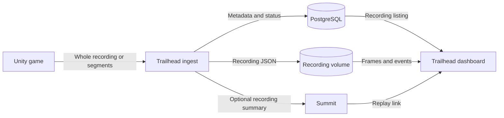

# Trailhead

Trailhead records the motion and events of a Unity session and replays them in
a browser. Use it to see where a player moved, what a tracked object was doing,
and which events occurred around a point in the recording.

[Replay the bundled sample](first-replay.md) to try the viewer.
[Record from Unity](unity.md) to instrument a scene, or see the
[recording and sync reference](recording.md) for upload and storage details.

## From a Unity scene to the replay viewer

The dashboard reads metadata from PostgreSQL and loads the recording JSON
from disk for playback. A summary in Summit can link back to that replay.

## Source map

| Area | Location |
| --- | --- |
| Unity recorder | [Client example and API guide](https://github.com/Unity-Environmental-University/Trailhead/tree/main/clients/unity) |
| Replay controls and view | [Viewer components](https://github.com/Unity-Environmental-University/Trailhead/tree/main/dashboard/components/recording-viewer) |
| Payload structure | [Recording types](https://github.com/Unity-Environmental-University/Trailhead/blob/main/dashboard/lib/recording-types.ts) |
| Database setup | [SQL migrations](https://github.com/Unity-Environmental-University/Trailhead/tree/main/backend/migrations) |
