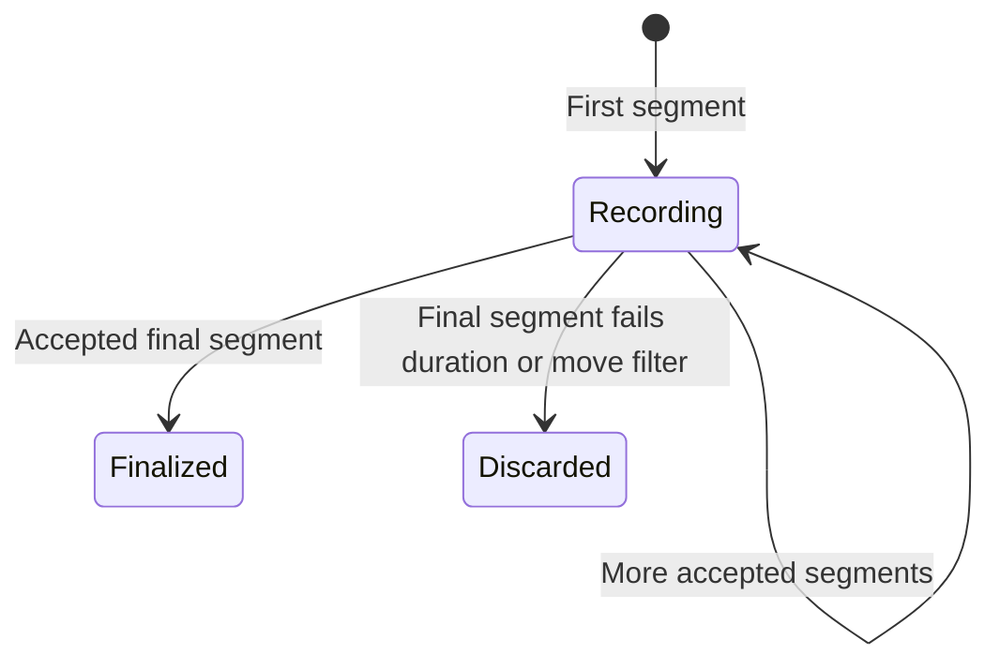

# Recording and sync reference

## Ingest routes

Trailhead uses the `/trailhead` base path. Both upload routes take the Trailhead
`API_KEY` in `x-api-key` and accept JSON or gzip-compressed JSON with
`Content-Encoding: gzip`.

| Mode | Route after the base path | Recording ID | State |
| --- | --- | --- | --- |
| Whole recording | `POST /api/recordings` | Trailhead assigns it and returns it with `201` | Finalized on acceptance |
| Incremental | `POST /api/recordings/{id}/segments` | The client chooses a UUID before the first request | Playable after upload, finalized by a segment with `final: true` |
| Replay | `GET /recording?id={id}` | The same ID used by the gallery and Summit link | Loads the saved frames and events |

The default body ceilings are 16 MiB for a whole recording and 2 MiB per
segment. Trailhead applies limits to the decoded JSON as well. The whole-file
route returns `422` if its recorded duration is under 20 seconds or its recorded
move count is zero, when those values are supplied. The incremental route can
report `discarded: true` for those conditions on finalization.

## Incremental recordings

Each segment has a stable `segmentId` for retries. Send only new frames and
events, address subjects by index, and set `isNew` on a newly introduced
subject. A retried segment reuses its original ID. The server also drops frames
and events repeated by overlapping segments.

The first segment can also be the final segment. An interrupted client can
leave a playable recording in progress. PostgreSQL tracks recording state and
segment IDs, while the recording volume holds the JSON used in the viewer.

## Summit sync settings

| Setting | Purpose |
| --- | --- |
| `SUMMIT_API_URL` | Summit base URL, including `/summit` for the Docker or production build |
| `SUMMIT_APP_API_KEY` | Summit app key Trailhead uses to submit the summary |
| `TRAILHEAD_PUBLIC_URL` | Browser-facing Trailhead base URL, including `/trailhead`, used to construct replay links |
| `SUMMIT_SYNC_URL` | Optional full URL override for incremental upload syncs |

Trailhead submits summaries after accepting a whole recording or a segment.
The sync is best effort. A recording can play in Trailhead while its summary is
missing from Summit. Check the Summit URL and key, and confirm that the
recording's `summit_session_id` belongs to an existing Summit session.
