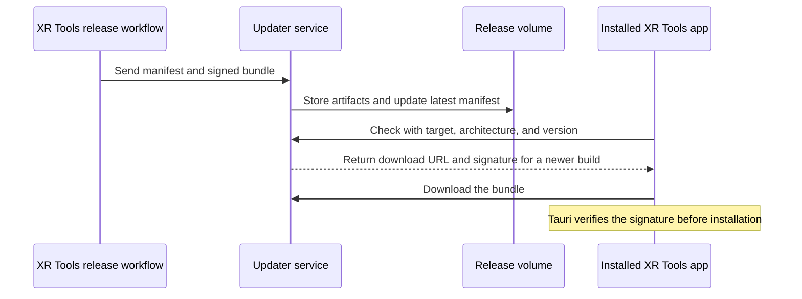

# XR Tools Updater Service

The updater service distributes signed XR Tools updates. Release CI sends a
Tauri manifest and platform bundle. An installed app asks whether it has an
update for its platform and current version.

The service rewrites the manifest's download URLs to point at its hosted
artifacts. Uploads for the same version can add platform entries to the version's
manifest. The app-level manifest determines which version clients see.

See [Check an updater release](verify.md) for the API and a readiness check.
For server setup, use the [repository README](https://github.com/Unity-Environmental-University/XR-Tools-Updater-Service#readme).
