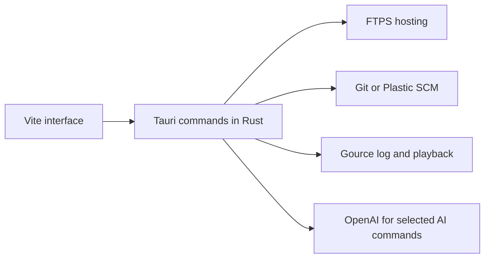

# XR Tools

XR Tools is a Tauri desktop app for the people who build and publish XR
experiences. It can upload a web build over FTPS, generate commit and changelog
drafts, and prepare a Gource visualization of a repository's history.

## Choose a tool

| Task | Tool | Requirements |
| --- | --- | --- |
| Upload a web build | FTP Deploy | A local build, hosting credentials, and a destination |
| Calculate biweekly pay dates | Pay Dates | The latest pay date and the number of years |
| Draft a Plastic SCM commit message | AI Commit | `cm` on `PATH` and an OpenAI API key |
| Visualize Git or Plastic SCM history | Gource Logs | `git` or `cm` on `PATH`, plus `gource` to play the visualization |
| Draft a changelog from history | Changelog | A Git or Plastic SCM checkout and an OpenAI API key for AI drafts |

Review the repository content selected for an AI draft before sending it.
The AI commands can send commit messages, status output, or diff content
to OpenAI. Review the generated text before you use it.

## How work leaves the desktop

Start with [a test deployment](deploy.md) if you are delivering a web build.
Use the [development and release guide](development.md) to work on the
desktop app itself.
